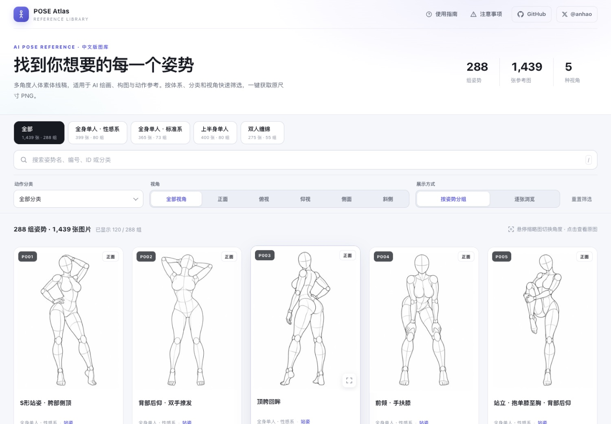

# AI Pose Gallery — English Edition

> A static, responsive gallery of AI pose references: 288 pose groups, 1,439 records, and 2,878 reference images.

> [!IMPORTANT]
> **English-language fork of the original project.** This repository is an English-oriented implementation based on [Anhao's `ai-pose-gallery-zh`](https://github.com/anhao/ai-pose-gallery-zh), which adapts the original Japanese pose gallery into a self-hostable static gallery. The original pose references and source data belong to the original creator, **ギア (@giaaibusi)**. Please also credit the original site and project when redistributing or adapting this work.
>
> - Original site: https://ai-pose-gallery.pages.dev/
> - Original creator: [ギア (@giaaibusi)](https://x.com/giaaibusi)
> - Upstream repository and Chinese implementation: [anhao/ai-pose-gallery-zh](https://github.com/anhao/ai-pose-gallery-zh)
> - Upstream maintainer: [Anhao (@anhao_ai)](https://x.com/anhao_ai)
>
> **Attribution and licensing:** The upstream repository states that the images and original data are not covered by its MIT license and remain the original creator's property. The MIT license applies only to the code and eligible project files; it does not grant rights to the image assets or original pose data. See [LICENSE](LICENSE) before reusing any content.



<details>
<summary>Mobile preview</summary>


</details>

**Upstream live demo:** https://ai-pose-gallery.anhao.app/

---

## Overview

The original gallery provides pose references for AI illustration, 3D work, and photography. Its source metadata is in Japanese, and the original site does not provide a bulk asset download. The upstream Chinese implementation packages the gallery as a responsive static site and includes a translated metadata dataset.

This repository is intended to make that project accessible to English-speaking users. The current code and data are inherited from the upstream implementation; English localization of the frontend and pose metadata may be ongoing.

The upstream implementation provides:

1. **A local asset mirror** — 1,439 JPG thumbnails (300 × 400) and 1,439 full-size PNG images (900 × 1200), for 2,878 files and approximately 659.5 MB.
2. **Translated metadata** — the upstream Chinese version maps the Japanese labels to Chinese across 4 systems, 26 categories, 288 pose names, and 5 viewing angles.
3. **A responsive, dependency-free gallery** — category filters, multi-angle switching, grouped browsing, lightbox navigation, and full-size image downloads, with a layout adapted for mobile.

## Features

- Four system tabs showing image and pose-group counts.
- Search by pose name, pose number, ID, or category keywords; press `/` to focus the search field.
- Combined filters for pose category and five viewing angles, with a one-click reset.
- **Grouped and individual browsing modes.** Group cards show thumbnails from multiple angles.
- Hover or click thumbnails to change the main viewing angle; click a card to open the lightbox.
- The lightbox displays a thumbnail first and then loads the 900 × 1200 original. Download PNGs, copy the pose ID, or open an image in a new window.
- Keyboard controls: `←` / `→` change angles, `↑` / `↓` change poses, and `Esc` closes the lightbox. Mobile devices support horizontal swipes.
- Multi-column desktop grid and two-column mobile grid, with a collapsible mobile filter panel.
- Guide and notice dialogs, plus image-source and maintainer links in the footer.

## SEO and social sharing

The upstream page includes SEO and social-sharing metadata:

- Descriptive page title, meta description, keywords, author, and `max-image-preview:large`.
- A canonical URL to avoid duplicate indexing across custom and `pages.dev` domains.
- Open Graph and Twitter Card metadata using the 1200 × 630 `og-cover.jpg` image.
- JSON-LD structured data for `WebSite` and `ImageGallery`.
- `robots.txt` and `sitemap.xml`.
- Semantic headings, descriptive thumbnail alt text, and lazy-loaded images.

**When deploying your own fork:** update the canonical URL, `og:*` and `twitter:*` metadata, JSON-LD, `robots.txt`, and `sitemap.xml` in line with your own deployment domain. The inherited metadata may still point to the upstream site.

## Dataset

| System (upstream Chinese labels) | Records |
| --- | ---: |
| Full-body, solo · standard | 365 |
| Full-body, solo · sexy | 399 |
| Upper-body, solo | 400 |
| Two-person interaction | 275 |
| **Total** | **1,439** |

Each record may include some of five viewing angles: front, oblique, side, top-down, and bottom-up.

## Repository structure

```text
.
├── index.html                # Single-page gallery
├── robots.txt                # Search engine crawling rules
├── sitemap.xml               # Sitemap
├── og-cover.jpg              # 1200 × 630 social-sharing image
├── data/
│   ├── pose.json             # Original Japanese data (1,439 records)
│   ├── pose-zh.json          # Chinese data used by the inherited frontend
│   ├── meta.json             # Original system/category metadata
│   ├── meta-zh.json          # Chinese system/category metadata
│   └── translations.csv      # Japanese–Chinese mapping (323 unique entries)
├── thumbs/                   # 1,439 JPG thumbnails (300 × 400; ~22 MB)
├── img/                      # 1,439 full-size PNGs (900 × 1200; ~637 MB)
├── scripts/
│   ├── download.py           # Concurrent downloader with resume/retry support
│   ├── i18n.py               # Japanese-to-Chinese translation mappings
│   ├── apply_translation.py  # Applies translations to generate Chinese data
│   ├── verify.py             # Checks file presence, size, and image headers
│   └── build.sh              # Prepares the Cloudflare Pages dist/ directory
├── docs/                     # README preview images
├── _headers                  # Cloudflare Pages cache rules
├── LICENSE
└── README.md
```

## Data schema

The inherited frontend reads `data/pose-zh.json`. Its fields include:

| Field | Original Japanese field | Example | Description |
| --- | --- | --- | --- |
| `id` | — | `full_sexy_P001_front` | Unique identifier |
| `体系` | `系統` | Full-body, solo · sexy | One of four systems |
| `姿势编号` | `ポーズ番号` | `P001` | Pose/group number |
| `分类` | `分類` | Standing | One of 26 categories |
| `姿势名称` | `ポーズ名` | S-shaped standing pose | Pose description |
| `角度` | `アングル` | Front | Viewing angle |
| `缩略图` | `サムネ` | `thumbs/…jpg` | Relative thumbnail path |
| `原图` | `原寸` | `img/…png` | Relative full-size image path |
| `检索` | — | Combined text | Search text used by the frontend |

The upstream keeps `data/pose.json` in its original Japanese schema for comparison and for regenerating translated data. The file names and field names shown above reflect the inherited upstream implementation and may change as the English localization develops.

## Run locally

The gallery loads JSON through `fetch`, so serve it over HTTP. Opening `index.html` directly from the filesystem may fail because of browser CORS restrictions.

```bash
python3 -m http.server 8000
# Open http://127.0.0.1:8000
```

The inherited page supports combined system/category/angle filters, keyword search, grouped or individual browsing, multi-angle thumbnails, lazy loading, full-size image downloads in the lightbox, and keyboard/touch navigation.

## Scripts

```bash
# Download images; existing files are skipped, so the command can be rerun.
python3 scripts/download.py
WORKERS=64 python3 scripts/download.py   # Adjust concurrency

# After editing scripts/i18n.py, regenerate the Chinese dataset.
python3 scripts/apply_translation.py

# Verify all 2,878 image files.
python3 scripts/verify.py
```

## Deploy to Cloudflare Pages

This is a static site without a framework or runtime dependencies.

### Option 1: Automatic deployment through GitHub (recommended)

1. Sign in to the Cloudflare Dashboard and open **Workers & Pages → Create → Pages → Connect to Git**.
2. Select this repository and the production branch, `main`.
3. Use these build settings:

   | Setting | Value |
   | --- | --- |
   | Framework preset | `None` |
   | Build command | `bash scripts/build.sh` |
   | Build output directory | `dist` |

4. Select **Save and Deploy**. After a few minutes, Cloudflare will provide a `https://<project>.pages.dev` address.
5. Subsequent `git push` operations trigger a new deployment automatically.

> [!WARNING]
> Do **not** set the build output directory to `/`. The repository root contains Git data and other large files. Cloudflare may scan them as static assets, and files larger than its 25 MiB per-file limit can cause deployment to fail. `scripts/build.sh` copies only the required site files into `dist/`.

The upstream documentation notes a 25 MiB per-file limit and a 20,000-file deployment limit. Its largest file is approximately 917 KB, and the built site contains about 2,883 files.

### Option 2: Deploy from the command line

```bash
bash scripts/build.sh
npx wrangler pages deploy dist --project-name ai-pose-gallery-en
```

The inherited `_headers` file configures one-year browser caching for files under `img/` and `thumbs/`.

## Content notice

The gallery contains adult-oriented pose references, and some category labels refer to sexual activity. It is intended for artistic creation, pose reference, and frontend development study. Do not use it for unlawful purposes. Minors should not access this content.

## Credits and rights

- **Original pose images and original source data:** © ギア ([X: @giaaibusi](https://x.com/giaaibusi)). The original site is https://ai-pose-gallery.pages.dev/.
- **Upstream gallery and Chinese implementation:** [Anhao / anhao/ai-pose-gallery-zh](https://github.com/anhao/ai-pose-gallery-zh). Maintainer: [@anhao_ai](https://x.com/anhao_ai).
- This repository is an independent English-oriented fork/implementation of the upstream project. It is not the original project and is not presented as an official release by the original creator.
- The upstream repository's MIT license covers eligible source code and project files only. It **does not cover** the images in `img/` and `thumbs/`, or the original pose data in `data/`. The upstream license states that these assets remain the original creator's property and are not authorized for commercial use under that license.
- Please review [LICENSE](LICENSE) and the original project's terms before reusing, redistributing, or commercially using any assets. This README does not grant additional rights to third-party content.

